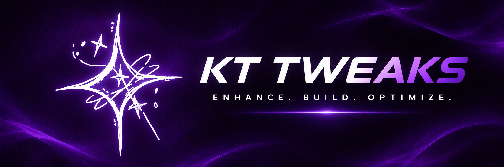

  
  

Projetos abertos para personalizar, automatizar e otimizar o Windows com transparência e controle.

  <a href="https://kt-wirzade-site.vercel.app/">Site</a> ·
  <a href="https://kt-wirzade-site.vercel.app/docs">Documentação</a> ·
  <a href="https://github.com/orgs/KT-TWEAKS/repositories">Projetos</a> ·
  <a href="https://kt-tweaks-apbx.vercel.app/">Playbooks</a>

